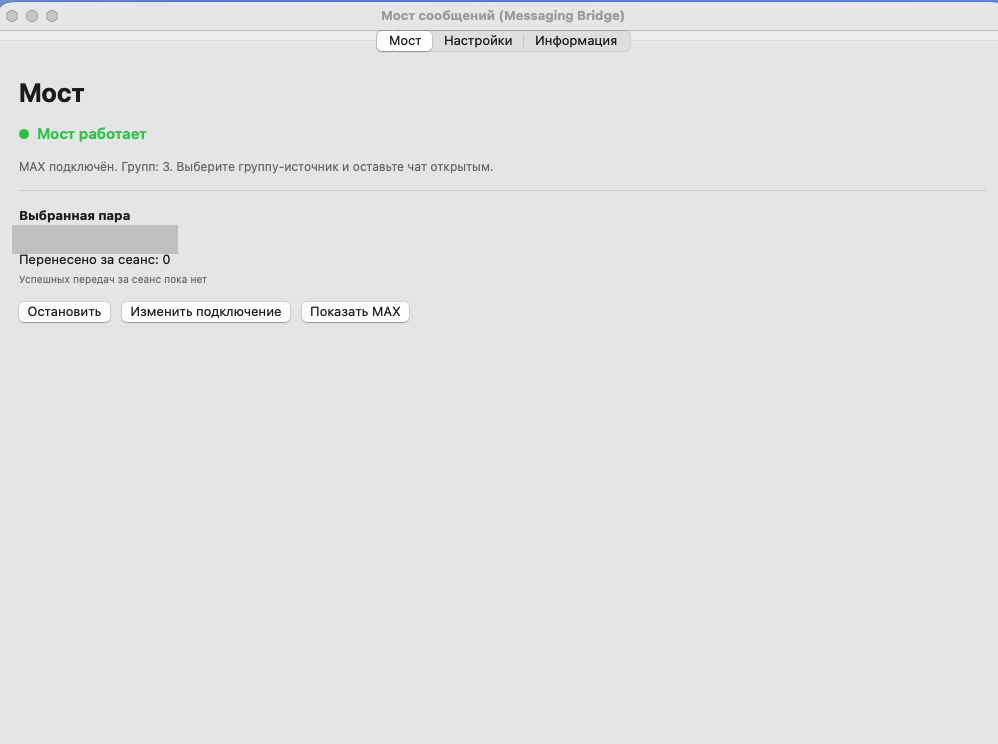

# Мост сообщений (Messaging Bridge) — локальный прототип на Swift

Connecting people.

> **Статус: прототип.** Публичного релиза, готового архива для скачивания и нотаризованной сборки нет. Подробности — в разделе [«Статус релиза и загрузки»](#статус-релиза-и-загрузки).

Мост сообщений нужен для спокойной связи двух семейных чатов — MAX и Telegram — без ручного копирования сообщений. Он пересылает только новые сообщения между двумя выбранными группами, сохраняет имена отправителей и переносит текст, фото, видео, GIF/анимации, голосовые и видеосообщения, а также документы. История, правки, удаления и сообщения из других чатов не переносятся. Голосовые и видеосообщения Telegram доставляются в MAX как воспроизводимый аудиофайл (`audio/ogg`) и обычное видео (`video/mp4`); родные «круги» и голосовые пузыри MAX не заявлены.

Приложение работает локально на macOS 14+: использует официальный веб-клиент MAX в WebKit, официальный Telegram Bot API и не имеет собственного сервера, аналитики или сторонних зависимостей. Один экземпляр моста обслуживает одну пару групп.

## Статус релиза и загрузки

Честно о том, что есть и чего нет:

- **Нет публичного релиза:** GitHub Release и тегов (`git tag`) не созданы. Готовый архив с приложением для скачивания не публикуется.
- **Первый публичный релиз — только Apple Silicon (`arm64`).** Публичная поддержка Intel отложена на неопределённый срок до проверки на реальном Intel-Маке. Необязательная кросс-сборка `x86_64` сохранена в скриптах только как проверка сборки и **не** означает поддержку Intel. CI на `macos-15-intel` полезен как регрессия сборки, но не как доказательство работы на Intel.
- **Прежние локальные превью-ZIP удалены.** Два артефакта `0.1` (`arm64` и кросс-`x64`) были собраны и проверены, но устарели после добавления голосовых и видеосообщений; оба ZIP и их `.sha256` удалены. Исторические детали — в [docs/RELEASE.md](docs/RELEASE.md). Новые архивы сейчас не создаются и не публикуются; для проверки поведения собирайте из исходников.
- **Нет страницы загрузки.** Публичный способ получить приложение — собрать его из исходников на своей машине (см. [«Сборка из исходников»](#сборка-из-исходников)).
- **Правка голосовых сообщений готовится к слиянию в `main` через PR.** `origin/main` пока не содержит её; зелёный CI `45640544891` относился к более раннему состоянию до правок упаковки и голоса. Результаты локальных проверок — в [docs/RELEASE.md](docs/RELEASE.md).
- **`dist/MessagingBridge.app` и установленное `/Applications/MessagingBridge.app` — локальные артефакты, не канал распространения.** Каталог `dist/` исключён из git. Сборка подписана **ad hoc** (`codesign --sign -`), **не** сертификатом Developer ID и **не** нотаризована; она предназначена для автора/локального теста.
- **Лицензия MIT выбрана и добавлена.** Условия — в [LICENSE](LICENSE) (copyright (c) 2026 mr-avp). Это не меняет статус прототипа и остальные ограничения, перечисленные выше.
- **Архитектуры.** Свежая сборка `arm64` собрана нативно на Apple Silicon и установлена локально; кросс-компиляция `x86_64` доступна по запросу, но на Intel-Маке не запускалась и не тестировалась. Универсальной сборки и опубликованной матрицы «одна версия — обе архитектуры» нет; статус — в [docs/RELEASE.md](docs/RELEASE.md).
- **Совместимость с текущим сервером MAX не гарантирована.** Сквозной тест с реальной учётной записью не выполнялся; см. [«Не подтверждено вживую»](#не-подтверждено-вживую) и [«Проверки»](#проверки).

Планы и контрольный список публикации — в [docs/RELEASE.md](docs/RELEASE.md) (черновик, ничего не опубликовано). Описание CI — в [docs/CI.md](docs/CI.md).

## Скриншот



Это **реальный скриншот приложения**, а не mockup. Перед публикацией с кадром проделано: имя выбранной группы закрыто непрозрачной плашкой, лишние края кадра (часть рабочего стола) обрезаны, метаданные PNG удалены. Кадр повторно просмотрен перед публикацией: видны только состояние интерфейса и кнопки, текстов сообщений и токенов нет. Оригинальные пользовательские изображения из `src/` в документацию **не включены и не публикуются**.

## Возможности

- Двусторонняя пересылка **только новых** сообщений между одной парой групп: MAX → Telegram и Telegram → MAX.
- Текст (включая Unicode-эмодзи, ZWJ-последовательности, оттенки кожи и флаги) без разрыва по графемам.
- Фото, видео, GIF/анимации, голосовые записи и видеосообщения, документы; подписи к медиа переносятся с учётом лимитов Telegram.
- Имена отправителей из MAX (контакт/профиль) или из имени/`@username` в Telegram; резервные подписи «Участник MAX»/«Участник Telegram».
- Работа в строке меню macOS, скрытый Dock, автозапуск при входе в систему и опциональное автовключение моста.
- Опциональное (выключено по умолчанию) автооткрытие сохранённой группы MAX при холодном старте, перезагрузке, выходе из сна и восстановлении после сбоя.
- Локальный журнал типизированных событий без текстов сообщений, токенов и персональных данных.
- Никакого сервера, аналитики, аккаунта в облаке и сторонних зависимостей.

## Установка и запуск

### Что понадобится

- **Доступ к MAX и Telegram с компьютера, на котором работает мост.** Обязателен исходящий HTTPS-доступ к Telegram Bot API — `api.telegram.org` (порт 443), включая загрузку файлов. Работа Telegram на телефоне или через прокси только внутри Telegram-клиента не означает, что API доступен приложению моста. Если доступ ограничен, сетевой маршрут/VPN/прокси должен обеспечивать доступ именно для моста.
- macOS 14.0 или новее; Xcode с Swift 6.0+ (в CI используется Xcode 16.4).
- Node.js 24.22.3 (LTS) — только для запуска JS-тестов.
- Исходники репозитория: `https://github.com/mr-avp/messaging-bridge.git`.

### Сборка из исходников

```bash
git clone https://github.com/mr-avp/messaging-bridge.git
cd messaging-bridge
scripts/build.sh
open dist/MessagingBridge.app
```

`scripts/build.sh` делает release-сборку SwiftPM, формирует `dist/MessagingBridge.app` и применяет локальную ad hoc подпись. Для повторной сборки достаточно снова запустить скрипт. Полный набор локальных команд — в [docs/CI.md](docs/CI.md).

Для локального превью с архивом и контрольной суммой запустите `scripts/package-preview.sh`. Архитектуру можно выбрать явно, например `MESSAGING_BRIDGE_ARCH=x86_64 scripts/package-preview.sh` (или `arm64`); без неё сборка нативная. Скрипт собирает свежий `.app` в **новом** игнорируемом каталоге `release-preview/messaging-bridge-0.1-<архитектура>-<время>/` (существующие `dist/`, прежние артефакты и установленное приложение не перезаписываются), использует отдельный кэш SwiftPM для каждой архитектуры, сверяет запрошенную архитектуру с готовым Mach-O через `lipo`, добавляет `LICENSE` и короткую инструкцию `INSTALL.ru.txt`, делает ZIP через `ditto` и рядом — файл `.sha256`. Дополнительных зависимостей и запуска приложения нет; сборка остаётся ad hoc, не нотаризованной и никуда не выкладывается. **Сейчас новые ZIP не создаются:** прежние архивы удалены, а публичный выпуск планируется только для Apple Silicon; скрипт остаётся необязательным локальным инструментом.

Для каждой сборки можно задать отдельный каталог через `MESSAGING_BRIDGE_OUTPUT_DIR` — например, свежую сборку в уникальном каталоге кэша без перезаписи `dist/`. Это позволяет ставить приложение из проверенного `.app`, не смешивая его со старыми артефактами.

Специальное переключение ветки перед сборкой не требуется: используйте каталог с нужными исходниками. Правки голоса и документации находятся в отдельной ветке и отправляются в `main` через PR; до слияния свежий `main` их не содержит (детали — в [docs/RELEASE.md](docs/RELEASE.md)).

### Предупреждение о подписи macOS (важно)

Сборка подписана **ad hoc** (`codesign --sign -`): это локальная подпись без Developer ID и без нотаризации. Она подтверждает только целостность конкретной сборки, **не** удостоверяет личность разработчика и **не** проходит нотаризацию Apple. Поэтому:

- macOS может заблокировать первый запуск («приложение повреждено» / «не удалось проверить разработчика»). Для **конкретного файла, который вы собрали сами**, используйте контекстное меню → «Открыть» или Системные настройки → «Конфиденциальность и безопасность» → «Открыть всё равно». После изменения содержимого бандла подпись перестаёт быть действительной — пересоберите приложение.
- **Не отключайте защиту системы целиком:** не выполняйте `spctl --master-disable`, не выключайте SIP и не включайте глобальное «Разрешить приложения откуда угодно». Не запускайте сборки, происхождение которых вам неизвестно.
- Если в будущем понадобится публичная загрузка, потребуется отдельное решение по подписи Developer ID и нотаризации; в текущих материалах это не сделано.

### Настройка

1. Создайте отдельного Telegram-бота через официальный @BotFather:
   - отправьте `/newbot`;
   - укажите имя, например `Мост сообщений`;
   - укажите username, оканчивающийся на `bot`, например `family_bridge_bot`;
   - сохраните выданный токен и вставьте его в приложение.
   Отключите Group Privacy: `/setprivacy` → ваш бот → Disable. Если бот был добавлен в группу до отключения privacy, удалите и добавьте его снова. Один и тот же бот можно добавить в несколько групп: отправьте `/family` в каждой нужной группе и выберите подключение в приложении.
2. Создайте группу Telegram, добавьте семью и бота. Если бот был добавлен до отключения privacy, удалите и добавьте снова.
3. Введите токен в защищённое поле приложения, нажмите «Подключить бота». Токен сохраняется в локальном хранилище приложения, а поле очищается. При следующем запуске бот подключается автоматически.
4. Отправьте `/family` в группу Telegram, нажмите «Найти группу» и выберите её.
5. Нажмите «Открыть / перезагрузить MAX» и войдите на официальном сайте в правой части приложения. Выберите группу MAX и оставьте её открытой справа: веб-клиент подписывается на сообщения открытого чата.
6. Проверьте обе группы и нажмите «Включить для выбранной группы». Сохраните подключение кнопкой «Сохранить текущее».
7. Отправьте уникальный тестовый текст из MAX, затем из Telegram. Проверьте по одной копии в другой группе и отсутствие эха.
8. Отправьте сообщение в другой чат: оно не должно попасть в тестовые группы. Нажмите «Стоп» и убедитесь, что пересылка прекратилась. Уже отправленный сетевой запрос отозвать нельзя.

## Автозапуск и строка меню

- «Автозапуск при входе в систему» создаёт пользовательский LaunchAgent (`~/Library/LaunchAgents/local.messaging-bridge.plist`) с путём к текущему исполняемому файлу. Он запускает приложение при входе в macOS. Если переместили приложение, выключите и снова включите настройку, чтобы обновить путь.
- **Автозапуск приложения при логине и автовключение моста — разные вещи.** Первый — файл LaunchAgent в `~/Library/LaunchAgents/` и запись launchd с меткой `local.messaging-bridge`; вторая — настройка самого приложения, которая запускает пересылку только после готовой сессии MAX и подключённого бота. Запись launchd вида `application.local.messaging-bridge.<...>`, которая появляется у уже запущенного приложения, относится к работающему экземпляру и **не** является login item: она не заменяет plist и не гарантирует запуск после выхода или перезагрузки.
- Настройка автозапуска хранится отдельно от plist: если файл удалён или карточка приложения перемещена, приложение не восстанавливает plist само. Перед расчётом на автозапуск проверьте наличие файла; чтобы пересоздать его, нужно явно выключить и снова включить настройку (это изменит login item и требует согласия пользователя).
- «Автовключение моста при запуске» включает пересылку, когда бот подключён, сессия MAX готова и обе выбранные группы найдены. Для восстановления пары сохраните подключение. При выключенной настройке запускайте пересылку кнопкой «Включить для выбранной группы».
- Значок моста находится в строке меню macOS, значок в Dock скрыт. Холодный запуск не показывает окно: модель, MAX и пересылка работают без него. Закрытие окна скрывает его, а пересылка продолжает работать. Пункт «Открыть Мост» создаёт окно настроек (или показывает уже созданное), открытие приложения в Finder повторяет это поведение, пункт «Выйти» завершает приложение.

## Автооткрытие сохранённой группы MAX (опт-ин)

- Настройка «Автоматически открывать выбранную группу MAX» в разделе «Настройки → Автоматизация» **выключена по умолчанию**. При включении MAX открывает сохранённую группу при холодном запуске, перезагрузке, выходе из сна и восстановлении после сбоя; без неё загружается корень `https://web.max.ru`. Выключение возвращает открытие на корень и не закрывает текущий чат принудительно.
- **Внимание:** открытие чата в веб-клиенте может отметить сообщения прочитанными и сменить активный чат — это видно собеседникам. Кнопка «Открыть сохранённую группу MAX» делает тот же переход вручную и доступна, даже если автоматизация выключена.
- Источник ID — только числовой ID **выбранного сохранённого подключения**; ID из просто найденной группы или введённый вручную не используется. Недопустимые значения (не цифры, символы path/query, слишком длинные) отбрасываются, и загружается корень. URL строится только как `https://web.max.ru/<проверенный id>`; навигация пользователя и события `ready` не перехватываются. Кнопка ручного открытия задаёт цель только на один переход и не меняет настройку: последующие автоматические загрузки снова выводят цель из опции и сохранённого подключения.
- Выход из сна, отключение и восстановление **принудительно** перезагружают MAX даже если адрес уже `/<id>`: сам path не подтверждает, что WebSocket жив, иначе восстановление могло бы навсегда остаться без `ready`. Цикла перезагрузок при этом нет — повтор происходит только по реальному событию. No-op допустим лишь для ручного перехода на уже открытый здоровый чат.
- Это не закрепление (pin) чата: pin меняет порядок списка чатов и не является переходом по URL; закрепы MAX мост не меняет.

### Не подтверждено вживую

- Маршрут `/[[chatId]]/[[messageId]]/[[commentId]]` и построение URL `/${chatId}` найдены в публичном бандле веб-клиента (`chunks__D0OzoqHp.js`; `_buildUrl` находится именно в chunks, а не в `entry/app`), но **успешное открытие конкретной сохранённой группы под реальной учётной записью не проверено** — для этого нужен вход пользователя. Чувствительные чаты и права доступа могут отказать в открытии.
- Отметка прочитанного (opcode `50` `READ_MESSAGE` в бандле) и смена активного чата **не проверены вживую**: предупреждение основано на коде веб-клиента, а не на сквозном тесте. Подтверждения прочитанного в отчёте нет.
- Поведение после входа, если пользователь успел уйти с `/<id>` на другую страницу MAX, не проверено.
- Пересылка голосовых и видеосообщений **вживую не проверялась**: тесты подтверждают разбор `voice`/`video_note`, скачивание через Bot API и вызов MAX-отправки с правильными байтами, MIME и именем, но воспроизведение полученного вложения в реальном чате MAX должен проверить пользователь. Проверьте отдельно длинное сообщение (>20 МБ) — оно должно быть пропущено с предупреждением, а не тихо исчезнуть.
- Обратное направление (голос/видеосообщение MAX → Telegram) остаётся **неразрешённым**: в доступных санитизированных фикстурах нет ни одного такого вложения, а публичные описания протокола не дают подтверждённого способа получить URL и тип вложения именно из веб-сессии. Соответствие не гадается; реализована только диагностика.
- **Intel.** Кросс-сборка `x86_64` получается на Apple Silicon, но на реальном Intel-Маке не запускалась и не тестировалась. Публичная поддержка Intel отложена на неопределённый срок; первый публичный выпуск — только `arm64`.

## Архитектура и ограничения сессии

- Один экземпляр моста обслуживает **одну выбранную пару групп**: один открытый чат MAX и одну группу Telegram.
- MAX использует официальный веб-клиент в WebKit. Сообщения MAX приходят только для чата, который открыт в правой части приложения; поэтому выбранный чат MAX нужно оставлять открытым.
- Токен Telegram хранится в локальном хранилище приложения и подключается автоматически при запуске. Список групп и сохранённые подключения хранятся локально.
- Один бот Telegram может работать в нескольких группах, но мост переносит только выбранную пару групп за раз. Для другой пары остановите мост и выберите сохранённое подключение.
- Одновременный релей нескольких MAX-групп в одном экземпляре невозможен из-за ограничения веб-сессии MAX.

## Границы прототипа

- Только новые сообщения: текст, фото, видео, GIF/анимации, голосовые записи и видеосообщения, документы. Нет переноса истории, правок, удалений, реакций, связи reply и других типов вложений. Подпись берётся из имени участника в MAX (контакт/профиль) или из имени/`@username` в Telegram; если имя неизвестно, используется «Участник MAX»/«Участник Telegram». Unicode-эмодзи, включая ZWJ-последовательности, оттенки кожи и флаги, передаются без изменений.
- MAX → Telegram: фото передаётся по публичной ссылке MAX, видео — по ссылке, полученной через opcode 83. GIF из MAX (VIDEO или FILE) распознаётся по имени, MIME или URL и отправляется как `sendAnimation`, чтобы в Telegram он остался анимацией; обычное видео идёт через `sendVideo`, документы — через `sendDocument` с настоящим MIME. Голосовые и видеосообщения из MAX **не пересылаются**: надёжного соответствия между вложениями веб-клиента и входящим аудио нет; при `_type: "AUDIO"` мост пишет диагностику `media` и пропускает вложение, не выдумывая opcode и не выдавая это за поддержку. Telegram → MAX: фото, видео, анимация, голосовые записи и документ скачиваются через Bot API и загружаются в MAX через родной протокол веб-клиента; для загрузки передаётся Content-Type по расширению файла. Подписи к медиа ограничены 1024 видимыми UTF-16 единицами; остаток текста отправляется отдельными сообщениями, границы эмодзи не разрываются.
- **Как именно переносятся голосовые и видеосообщения Telegram → MAX.** `voice` (Opus/Ogg) загружается проверенным путём FILE с именем `voice.ogg` и MIME `audio/ogg`; `video_note` (MP4) — проверенным путём обычного VIDEO с именем `video_note.mp4` и MIME `video/mp4`. Это осознанный резервный вариант: байты и подпись доходят без изменений и воспроизводятся, но **родной голосовой пузырь или круг MAX не воссоздаётся** — такие семантики веб-протокола не подтверждены. Если Telegram прислал `mime_type`/`file_name`, они сохраняются; иначе используются эти значения по умолчанию. Сообщение без подписи всё равно доставляется с меткой автора (например, `Анна:\n`).
- Ограничения Telegram Bot API проверяются до скачивания: бот не может скачать файл больше 20 МБ (этот лимит одинаков для всех видов вложений, включая голосовые и видеосообщения), поэтому такое вложение пропускается с предупреждением, а текст (если он есть) передаётся отдельно. Фото в Telegram ограничено 10 МБ, видео/анимация/документ — 50 МБ; при отказе API мост отправляет ссылку на файл вместо остановки. Лимиты загрузки самого MAX не документированы и не проверяются заранее.
- Видимой служебной подписи в сообщениях нет. Эхо собственных отправок MAX отсекается по ID из ответа сервера; старые сообщения с прежней подписью «семейный-мост» всё равно игнорируются.
- Выход из приложения, сон Mac и ошибки сети могут прервать пересылку. Приложение не удерживает Mac от сна, а LaunchAgent не перезапускает мост после выхода или сбоя.
- При ошибке отправки мост останавливается, кроме временного лимита Telegram (429): он выдерживает паузу из ответа API и повторяет отправку до четырёх раз. При потере ответа сообщение могло быть доставлено, поэтому остальные ошибки останавливают мост. Недоставленная очередь в памяти теряется при остановке. После возобновления накопленная история не переносится.
- Лимит текста — 4000 видимых UTF-16 единиц, подписи к медиа — 1024. Длинный текст делится на несколько сообщений по границам графем, поэтому эмодзи и HTML-сущности не разрезаются. Между отправками — небольшая пауза 0,35 секунды; при лимите Telegram используется подсказанная сервером задержка. Очередь — до 100 сообщений.
- MAX использует неофициальный бинарный протокол официального веб-клиента: WebSocket `wss://api.oneme.ru/websocket`, MessagePack v10, сжатие LZ4. Заголовок кадра — 10 байт: версия, команда, seq (signed int16), opcode (signed int16), флаг сжатия и 24-битная длина. Готовность определяется по успешному ответу на вход (opcode 19 для нового входа или 23 для сохранённой сессии), события приходят через opcode 128, отправка — через opcode 64, полный список чатов — через opcode 53, URL видео — через opcode 83, загрузка фото/видео — через opcode 80/82 с последующим HTTP POST на выданный URL. Собственные запросы моста используют отрицательный диапазон seq, чтобы не пересекаться со счётчиком веб-клиента (0–32767). Если формат, адрес или тип группы изменится, потребуется адаптация. Вход, список чатов, отправка и загрузка медиа проверены на текущем сервере; сквозная пересылка MAX ↔ Telegram проверяется вручную. Публичные сторонние описания упоминают `_type: "AUDIO"` и загрузку аудио через opcode 82, но это описания другого транспорта/клиента: подтверждённого соответствия для входящих вложений веб-клиента нет, поэтому новая поддержка в обратную сторону не заявляется.
- Список MAX сначала берётся из ответа авторизации (там только первые 15 чатов), затем приложение отдельно запрашивает полный список через opcode 53. Если нужной группы всё равно нет, откройте её в MAX и нажмите «Открыть / перезагрузить MAX». Не вводите ID наугад.

## Данные и доступ

Relay не пишет тексты сообщений, токены, ответы API и сетевые ошибки в логи или собственную БД. Очередь хранится в оперативной памяти. Содержимое других чатов не передаётся из веб-клиента MAX в Swift. В Swift проходят только метаданные групп и выбранные сообщения.

Официальный веб-клиент MAX загружает аккаунт целиком и может сохранять собственные данные в WebKit. Его сессия не ограничена одной группой. Это не гарантия отсутствия личных данных на диске: WebKit управляет кэшем и данными сайта. Хранилище приложения отделено от Safari. Завершить сессию можно в MAX → Устройства.

Токен Telegram хранится в локальном хранилище приложения, не в исходниках. Telegram-клиент использует URLSession ephemeral. Личный аккаунт Telegram не подключается. Сеть: официальный веб-клиент и его ресурсы MAX, официальный api.telegram.org. Для работы моста компьютер, где установлено приложение, должен иметь исходящий HTTPS-доступ к `api.telegram.org` (порт 443). Если корпоративный прокси или firewall блокирует этот адрес, подключение бота и пересылка работать не будут. Аналитики и стороннего relay-сервиса нет.

## Журнал событий

- Журнал хранится локально в `~/Library/Application Support/MessagingBridge/events.jsonl` (JSON Lines, права 0600).
- В журнал пишутся только типизированные события: запуск/завершение приложения, запуск/ручная остановка моста, подключение/отключение MAX и Telegram, попытки/успех/блокировка/ошибка восстановления. Тексты сообщений, токены, URL, payload, имена и ID чатов/участников и содержимое вложений не пишутся.
- Журнал ограничен 500 событиями и размером файла до 1 МБ; при превышении старые записи удаляются. Ошибки чтения/записи не прерывают работу приложения.
- Очистить журнал можно кнопкой «Очистить» в разделе «Информация → Журнал» или «Для разработчика»; файл при этом удаляется.
- Диагностика не вызывает чтение секретов.

## Проверки

- `swift test` — политика допустимых сообщений, запрет чужих чатов, ботов и эха, а также автооткрытие: корень по умолчанию, знаковый/недопустимый ID, холодный старт с сохранённым подключением, opt-in/off и смена подключения, цель перезагрузки/сна, отсутствие цикла и повторное `configure` после `ready`.
- `node scripts/test-max-filter.js` — граница JavaScript/Swift: бинарный кадр v10, signed int16 seq, кодек MessagePack, отключённый мост, личные чаты, старые и изменённые события, эхо, реальные имена, приём и загрузка фото/видео, полный список групп, восстановленная сессия, отправка, очистка метаданных и разрыв соединения.
- `node scripts/test-emoji-gif.js` — Unicode-эмодзи (ZWJ, оттенки кожи, флаги, keycap, variation selector), смайлы, GIF как FILE и VIDEO, MIME-подсказки, Content-Type при загрузке в MAX и диагностика неподдерживаемого вложения `AUDIO`. Это имитация relay, а не живая пересылка.
- `swift test` дополнительно проверяет классификацию GIF/animation/document, лимиты Telegram, разбиение текста без разрыва эмодзи и HTML, payload-ы `sendAnimation`, `sendVideo`, `sendDocument` и `sendMessage` через подменённый URLProtocol (без сети), а также разбор `voice`/`video_note` и сквозной путь `start()` → `getFile` → `max.sendMedia` с проверкой байтов, MIME, имени файла и метки автора. Отдельно проверено, что стандартные GIF/видео/документ не изменились и что вложение больше 20 МБ пропускается с предупреждением, не останавливая мост.
- Эти проверки не доказывают совместимость с текущим сервером MAX. Для этого требуется вход пользователя и сквозной тест, включая воспроизведение голосовых и видеосообщений в MAX.

## За рамками текущей версии

- **Windows.** Это возможное направление будущей разработки, а не часть текущего прототипа: готовых сборок под Windows, сроков и обещаний нет. В коде есть только комментарии о будущем адаптере WebView2; приложение на Windows не собирается и не тестируется.
- **Intel как публичная платформа.** Поддержка Intel отложена на неопределённый срок до проверки на реальном оборудовании; необязательная кросс-сборка и Intel CI остаются инструментами проверки сборки, а не обещанием совместимости.

## Поддержка

- Для ошибок используйте шаблон [«Сообщение об ошибке»](.github/ISSUE_TEMPLATE/bug_report.md), для идей — [«Предложение функции»](.github/ISSUE_TEMPLATE/feature_request.md).
- В отчёте указывайте версию macOS, архитектуру (Intel/Apple Silicon), версии Xcode/Swift и Node.js, коммит сборки и шаги воспроизведения. По возможности приложите результат трёх проверок из раздела [«Проверки»](#проверки).
- **Сохраняйте приватность:** не прикладывайте токены Telegram, ID чатов и пользователей, `@username`, реальные имена и аватары, тексты сообщений, неотредактированные скриншоты и локальные пути. Журнал событий содержит только типизированные события, но перед отправкой всё равно проверьте его вручную.
- Время ответа и принятие предложений не гарантированы: это локальный прототип без сервиса поддержки.

## Источники сведений о протоколе

Изучены только как справочный материал, не запускаются и не подключаются как зависимости:
- https://github.com/mochensky/max-user-api
- https://github.com/Aist/max2tg
- https://github.com/GoPro3400/max-in-tg
- https://github.com/pr0bel1230/max-api-docs — стороннее описание протокола; упоминание `_type: "AUDIO"` и opcode 82 использовано **только** как повод для диагностики неподдерживаемого вложения, а не как основание для обратной пересылки (нет подтверждения для веб-сессии и санитизированных фикстур).
- https://core.telegram.org/bots/api — поля `voice` и `video_note`, лимит `getFile`, форматы Opus/Ogg и MP4.

Код приложения написан отдельно на Swift и JavaScript; сторонних пакетов нет.
